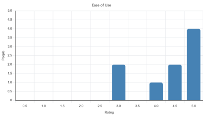

# Cover Page

Team Members: Cole Amacker, Tim Heiser, Veronica Rine, 
James Yoho, Isaiah Zimmerman

September 24th, 2026

## Introduction
The military operates a large number of devices on closed, air-gapped networks. Because these environments cannot reach external infrastructure, the software used often lags behind the commercial industry and hostname mappings are often scattered in excel spreadsheets. Additionally, the air-gapped networks often block standard broadcast discovery protocols, which can make it harder to keep track of the health of a network. Our platform will work within these constraints to upgrade the outdated systems that are currently in place.

Our platform replaces manual tracking by giving TurbineOne engineers and military personnel an integrated, locally hosted DNS and network management tool. The application pairs authoritative local DNS resolution for both IPv4 and transitional IPv6 allocations with bidirectional Excel import and export utilities to ease migration. Through a centralized web dashboard, administrators can manage user access across segmented subnetworks, review and approve device registration requests, and maintain clear records of device ownership. To support day-to-day operations in constrained environments, the software also provides active reachability testing, node health checks, and persistent metadata logging, giving field teams immediate visibility into device connectivity and hardware status without external dependencies.

## Representative Tasks
The list of tasks below is intended to give a sample of what types of use cases our platform will have. We hope that the list is thorough, but it is not meant to be a comprehensive technical list of tasks.  

> [!IMPORTANT]
> **INSTRUCTOR COMMENT — ACTION REQUIRED**
>
> Please mark which of the following are mvp tasks.

### 1: Health Checks - Unsolved Failure
Matt, a senior field engineer at T1, is monitoring the health of a military base's network hosted on f-dns. When he checks on the network status, he immediately sees that a high value server is down on the network. Matt immediately sends a ping to the server to try and diagnose the problem, and recieves no response. He knows there are engineers assigned to maintain this device, and pulls up the metadata of the server to check who is responsible.

In the metadata, he sees that the server has been down for more than 15 minutes, and that Tim and Cole are the engineers assigned to this part of the network. According to the metadata, Tim has been alerted, but neither employee has responded. Matt immediately sends an alert to both engineers. Cole acknowledges the alert and begins working on diagnosing and fixing the issue.

> [!IMPORTANT]
> **INSTRUCTOR COMMENT — ACTION REQUIRED**
>
> Seems like the 15 minutes should be apparent on the initial screen where he sees the server is down, rather than requiring him to pull up additional information about the device.

### 2: Health Checks - Diagnosing and Fixing
James, a field engineer onsite at a military base, receives a notification by text that a datacenter on the network he is assigned to is down. He quickly pings the server, and is able to diagnose the issue. After resetting the datacenter, the metadata is updated, recording the downtime, as well as James' ping request, diagnosis, and reset of the server.

> [!IMPORTANT]
> **INSTRUCTOR COMMENT — ACTION REQUIRED**
>
> I think you are overusing "metadata".  perhaps a log entry is created here and  a mention that the app no longer shows this resource as being down (but this would not be automatic if the app has to wait for its next scheduled ping - unless there is a way to report to the app from the alert that the issue has been fixed - triggering an unscheduled ping.  

### 3: Health Checks - Analyzing Uptime
Matt has had some concerns about the uptime of the datacenter that James just fixed in the previous task. He pulls up the metadata of the datacenter to look at its statistics, seeing the recent outage, as well as James' fix. Included in the metadata is an uptime report, showing that the datacenter has only been able to maintain about 90% uptime, which is much lower than expected. Matt is then able to use this data to assess if the datacenter needs to be replaced or updated.

> [!IMPORTANT]
>**INSTRUCTOR COMMENT — ACTION REQUIRED**
>
>Please include a representative task that demonstrates how monitoring is initially set up for a device. When does F-DNS start regularly pinging a device? How does the application distinguish between a device that has not yet been brought online and one that has gone down? When does downtime begin counting against a device's uptime statistics?  Unless you are requiring devices to already be live and attached to a local network before your excel or manual upload.

### 4: Health Checks - Topology Analysis
Tim is a senior field engineer in charge of a large military base network, who recieves notifications for a large part of the network going down suddenly. To diagnose what might be causing a problem for such a large chunk of the network, he pulls up the automatically generated topology map for the network.

After pulling up the topology map, Tim notices that all the devices that are down are part of one subnetwork, all routing through a single router that is also down. Tim sends a ping to this router, and gets no response, realizing that this is the likely failure point. Tim then checks the metadata to see what engineers are responsible for this part of the network. He sends notifications to James and Veronica, and they rush to diagnose and fix the issue.

> [!IMPORTANT]
> **INSTRUCTOR COMMENT — ACTION REQUIRED**
>
> Where does the information used to generate the topology map come from? Is it provided by an administrator, inferred from IP addresses and subnet information, or discovered from the actual network?
>
> Please clarify whether this visualization represents the expected network topology or the actual network topology. These are very different things. It sounded from chatting wity you that you were doing some sort of traceroute call?

### 5: Admin Dashboard - Excel Upload
Matt is an admin working on setting up a new subnetwork for a military base in California. He has a list of all the devices that need to be added to the subnetwork, but they are in the military’s standard Excel spreadsheet format. Matt uploads the Excel sheet of devices to f-dns. The f-dns application then automatically takes this data and uses it to generate the subnetwork to a DNS server or servers with all of the devices in the dataset, tracking each device’s IP, assigning each a domain name, and attaching all provided metadata. The subnetwork is then ready for use and for user/employee accounts to be added.

> [!IMPORTANT]
>**INSTRUCTOR COMMENT — ACTION REQUIRED**
>
>Please clarify what you mean by generating a subnetwork. My understanding is that you are populating a DNS server with records for these devices, not actually creating the subnetwork. Presumably, the network infrastructure must already be configured, the devices must have appropriate IP addresses, and the devices must be configured to use the DNS service you are managing (either directly or indirectly). Please make these assumptions clear throughout your representative tasks.

### 6: Admin Dashboard - Excel Export
James must present to his team information on the devices in his subnetwork. Using f-dns, he exports the devices, their IP addresses, and their metadata to an Excel spreadsheet, deselecting any devices he does not want in the report. He now has an Excel spreadsheet with all the device data he needs which he can use to generate charts and tables for his presentation.

### 7: Admin Dashboard - Network Update
Veronica, a field engineer at T1, needs to add a laptop to a subnetwork she oversees at a military base. She has the IPv4, planned domain name, and a couple pieces of metadata information that need to be attached to the device on the network. With this information she opens a request to add the device to the network, manually putting in its details. She submits the request, which then sends a notification to Matt, her admin.

### 8: Admin Dashboard - Admin Approval
Matt has recieved a notification that Veronica has requested to add a laptop. From the notification, he pulls up the request. Upon review of the request, he notices some of the metadata on the laptop Veronica wants to add is incorrect. He then edits the incorrect metadata, approving the request after the change is made. The changes go through and the network is updated.

### 9: 
Zimms is a soldier who was just deployed to a military base out in the field somewhere. He's not particularly technical, but he came to the base with several computers he needs to get online. He needs to be able to get his devices communicating with a couple other desktops on base, and some drones that are heading to the field soon. As soon as he gets on base, he pulls up frontline DNS and submits requests to add each of his devices. An admin is notified of his request to add the devices, and they are quickly approved. As soon as his devices are approved, Zimms pulls up the network and checks on the devices that he needs to get connected with. He sees that his laptops can only communicate with that group of devices through x channel. Based on that information he is able to quickly and efficiently get his device transfering critical information to the other devices, without having to do any guesswork or needing any real networking skills.

> [!IMPORTANT]
>**INSTRUCTOR COMMENT — ACTION REQUIRED**
>
>What do you mean by "x channel"? How does F-DNS know which devices can communicate with one another? Please clarify what information the application provides to Zimms and what he must still do to establish connectivity. Registering a device in DNS does not itself establish network connectivity or grant permission to communicate with other devices.

### 10:
Cole is an officer in charge of a group of soldiers setting up at a military base. They are coming with several trucks full of a variety of devices that all need to be hooked up to the network on base. As soon as Cole is onsite, he quickly sets up one laptop, and as an admin uploads a spreadsheet of all of the devices that are supposed to be coming on base with him and his squad. F-DNS reads the excel sheet, but detects that there are a few repeated devices on it, and flags those devices. After fixing the repeat devices, Cole approves the upload and all of the devices are automatically hooked up to the network. Cole then pulls up the topology map of the network, to make sure everything is linked about how he expected, and sees a clear visualization of the network and the connections between the devices.

> [!IMPORTANT]
>**INSTRUCTOR COMMENT — ACTION REQUIRED**
>
>Your application won't actually connect these devices to the network, will it? I assume you are registering the devices and creating the appropriate DNS records. Please clarify what must already be configured on the devices and existing network infrastructure for this to work.
>
>Also, when does F-DNS begin monitoring these newly registered devices? Does Cole need to indicate that the devices are ready to be monitored?

> [!IMPORTANT]
> **INSTRUCTOR COMMENT — ACTION REQUIRED**
>
> I would like to see a representative task demonstrating the core DNS functionality of F-DNS. Assuming you are integrating an actual DNS server, show a scenario in which a user benefits from this DNS service without necessarily opening the F-DNS application.

> [!IMPORTANT]
> **INSTRUCTOR COMMENT — ACTION REQUIRED**
>
> I think logging will be an important part of your app as well, particularly for debugging failures --- please add a task showing log entries being viewed - seeing the time/user registered, timestamp of pings failures...

## Related Work
We believe that our product can be of greater use to TurbineOne than any existing open-source product, but many similar products already do exist. This section will give an overview of similar products and show how our product will be a unique combination of features from various existing products. 

### Product 1 - SolarWinds
SolarWinds [1] is an IP address manager that provides much of the same functionality we are looking to build in our own product. SolarWinds is designed as a modern alternative to keeping IP and DNS information in spreadsheets that can become difficult to manage at larger scales. It provides a user interface that allows network administrators to look at available IP addresses and monitor the status and usage of active addresses. Additionally, SolarWinds actively scans networks in order to perform health checks and record various pieces of metadata about network devices. 

Although the features listed above are very similar to the features we plan on building into our product, the foundational aspect of our product is a DNS server, whereas SolarWinds is an IP address manager. Because of this, SolarWinds offers a wider range of features than TurbineOne needs, and the extensive software suite comes with a high price tag, which is overkill for our specific use case. Additionally, since TurbineOne works with DoD customers, there are more stringent requirements for software, and a smaller, locally hosted piece of software will offer more flexibility.

### Product 2 - Infoblox DDI
Infoblox [2] aligns almost exactly with our product's goal, but it once again has a wider scope and more robust set of features than TurbineOne needs. Infoblox's service includes the management of DNS, DHCP, and IP addresses. Infoblox emphasizes its ability to manage networks that are transitioning from IPv4 to IPv6, which is one of the goals of our product as well.

Although the software Infoblox creates has largely the same purpose as the product we want to build, the scale, deployment footprint, and operational overhead of the two products differ significantly. TurbineOne is a quickly growing company that works with a variety of military customers, and its need is for a piece of software that can be quickly deployed in a variety of locations (we will aim to do this by having our product deployable through a Docker container). Infoblox is an industry leader in network management, but its product is bulky and expensive. Our goal is to create a product that is streamlined to a narrower set of needs and easily deployable in an offline setting. 

### Product 3 - Auvik 
Auvik [3] is a network monitoring platform that focuses on the live state of the network instead of managing IP addresses and DNS servers. Our product will be considerably different from Auvik because we are primarily interested in providing TurbineOne with an easily managed DNS server and network monitoring capabilities. However, Auvik does put a significant focus on network topology maps that allow users to see the network layout, network links, and the paths that network traffic flows through. This feature is not included in our MVP, but it is something that we hope to implement in some form after completing other basic aspects of our product. Because different devices in TurbineOne's networks will be mobile, we hope that our product will include a tool to visualize how the network links change as devices move. 

### Product 4 - CoreDNS
CoreDNS [4] is a lightweight Go-based DNS server. The software is modularized into plugins, so users can choose different plugins based on individual use cases, which keeps CPU usage low. CoreDNS is open source and containerized, so it can be easily deployed with minimal setup time. Our product will strive to be similar to CoreDNS, but with a few added features such as an administrative dashboard and network monitoring. The architecture of our product is especially similar to CoreDNS because our software will be written in Go and deployable in a Docker container.

## Results from User Testing of UI Version 1.0

### Testing Methods
A total of nine people participated in the FDNS UI testing. Two computer science students, six other students, and Mr. Amacker, our client, completed the testing. The target audience will be a mix of technical and non-technical people, so we used a similar mix for user testing. We asked eight testers to add a device, and six testers to find their device on the topology map, as these are some of the most common tasks users will perform. Two testers were asked to import or export device information to or from an Excel spreadsheet. The two questions we asked each of our testers were: 1) How easy was it to accomplish this task on a scale of 1=difficult to 5=easy? and 2) Is there anything you would change to make it easier?

### Results
All eight testers were able to add a device. However, several of them were not familiar with computers and needed an example of what was supposed to go in each field. For example, when asked for an IPv4 address, we instructed them to enter ‘127.0.0.7’. The average time it took the testers to add a device was 1 minute and 4 seconds, with the fastest time being 52 seconds and the slowest being 1 minute and 27 seconds.

All six testers were able to find their device in the topology quickly, without assistance. The average time it took the testers to find their device was 5 seconds, the fastest being 2 seconds, and the slowest being 8 seconds.

Both testers were able to quickly find where to import their Excel sheet to FDNS without assistance. It took one tester 13 seconds to find it, and the other 6 seconds. Both testers were able to find where to export an Excel sheet without assistance, but it took significantly longer than expected. The first took 1 minute and 11 seconds, and it took the second 1 minute and 31 seconds to find the export button. Some unexpected behavior was that three of the users completely ignored the side bar and only utilized buttons on the main section of the page.

On a scale of 1 being hardest and 5 being easiest, the testers reported an average of 4.3 on ease of use. However, two testers – notably including Mr. Amacker – returned a 3, one tester scored a 4, two other testers returned 4.5s, and the final four testers ranked the ease at 5. See the graph below.

The suggestions we received were as follows:

o	Give examples for the fields in the Add Device form

o	Add an ‘Import Excel’ button next to the ‘View Devices’ button on the Overview page

o	Choose a more accurate word than ‘template’ in ‘Download Excel template’ button

o	Make the ‘Add Device’ button larger

o	Choose a more descriptive word than ‘inventory’ or ‘Import Inventory’ on sidebar

o	Make it clearer that the Importing Inventory page is also where a user can export to Excel

o	Change the title of the Import Inventory page because it could be confused with Add Device

o	Make it easier to select the names of responsible engineers in the Add Device form using a drop-down menu

### Potential Improvements
In our Add a Device task, the goal was to add a device to the network by finding the location of the form and completing it. Testers struggled with determining the proper formatting of the form fields, particularly IPv4 addresses. Therefore, we decided to add placeholder text to the fields to make it easier for users to know what information goes in which field.

We are also considering changing the Assigned Engineers field in the Add a Device form from a text field to a dropdown menu so the user can reference the menu when assigning engineers to a device instead of slowing down to find and consult a separate list.

Given that it took users longer than it should have to find where to export device information to Excel, we realized we need to relabel some tabs and buttons to make it clearer that they can export device information in the same location that they import it.

## Bibliography
[1] SolarWinds Worldwide, LLC, "IP Address Manager (IPAM)," SolarWinds. Available: https://www.solarwinds.com/ip-address-manager/. [Accessed: Sep. 24, 2026].

[2] Infoblox, "DDI Solutions: DNS, DHCP, and IP Address Management," Infoblox. Available: https://www.infoblox.com/solutions/. [Accessed: Sep. 24, 2026].

[3] Auvik Networks Inc., "Automated Network Mapping Software," Auvik. Available: https://www.auvik.com/network-management-software/network-mapping-software/. [Accessed: Sep. 24, 2026].

[4] CoreDNS Authors, "CoreDNS: DNS and Service Discovery," CoreDNS. Available: https://coredns.io/. [Accessed: Sep. 24, 2026].